# Directional statistics

``` r

library(GMisc)
library(ggplot2)
library(purrr)
```

This document highlights some functions of the `GMisc` package related
to directional statistics and stereonets.

Directional data refers to anything that can be expressed in azimuths,
with the typical convention of the north corresponding to 0 and 360
degrees, and increasing clockwise (east is 90, south is 180, west is
270).

Another characteristic of this type of data is that it can fall in one
of the following categories:

- Directional: Has a specific orientation (direction), points in one
  direction, usually associated to lines. An example would be the pole
  of a plane.
- Non-directional: Does not have a specific orientation, points in two
  directions 180 degrees one from the other, usually associated with
  planes. An example would be the strike of a plane.

## Circular data

Circular data, also known as 2D, refers to data only defined by their
direction and not their inclination or dip, so only one set of
measurements is needed.

In this case, to perform proper statistics on non-directional data it is
necessary to transform it before applying any calculations. It is a
simple transformation by doubling each measurement, this way it goes
from non-directional to directional, and now all the statistics can be
applied.

### Basic stats

The main statistics that describe circular data are the mean direction
(\bar{\theta}), mean resultant length (\bar{R}), and circular variance
(s_0^2). The mean resultant length (\bar{R}) ranges between 0 and 1, and
the closer to 1 the more concentrated are the data and the closer to 0
the more dispersed is the data. The circular variance (s_0^2) is the
complement of the mean resultant length (\bar{R}) and its interpretation
is the opposite, the closer to 1 the more variation there is in the
data.

The function `dir_stats_circ` is used to obtain the basic statistics for
circular data. Its arguments are `x` a vector of angular measurements in
degrees, `dir` a switch to indicate if the data is directional (1) or
non-directional (0), and `conf.level` to determine the desired
confidence level. The result shows the statistics mentioned above, plus
the concentration parameter kappa (k), and the general width for the
cone of confidence. The concentration parameter (k) is another measure
of the dispersion, the higher it is the more concentrated (less
dispersed) is the data, and more likely to have a preferred mean
direction.

The first example shows a set of directional data, while the second
example shows a set of non-directional data.

``` r

x <- c(
  255,
  239,
  222,
  231,
  199,
  271,
  222,
  274,
  228,
  246,
  177,
  199,
  257,
  201,
  237,
  209,
  216
)
dir_stats_circ(x, dir = 1)
#>   theta.hat  N     R   Rbar circ.var circ.sd circ.disp kappa  cone
#> 1     228.4 17 15.29 0.8996   0.1004    0.46    0.2205 5.271 12.61
```

``` r

dir_stats_circ(carolina, dir = 0)
#>   theta.hat  N     R   Rbar circ.var circ.sd circ.disp kappa cone
#> 1      48.7 99 97.25 0.9823   0.0177   0.189   0.03541  28.5 1.07
```

### Rose diagram

The typical way to present directional data is with a rose diagram,
which is the equivalent of a histogram. In the case of directional data
it results in an asymmetric rose diagram, while in the case of
non-directional data it results in a symmetric rose diagram.

The function to plot this is `rose_diag_2D`, with the extra argument of
`width` for the width in degrees of the petals (bins). The plot shows
the data, and by thedault the mean direction in red.

``` r

rose_diag_circ(x, width = 30, dir = 1)
```

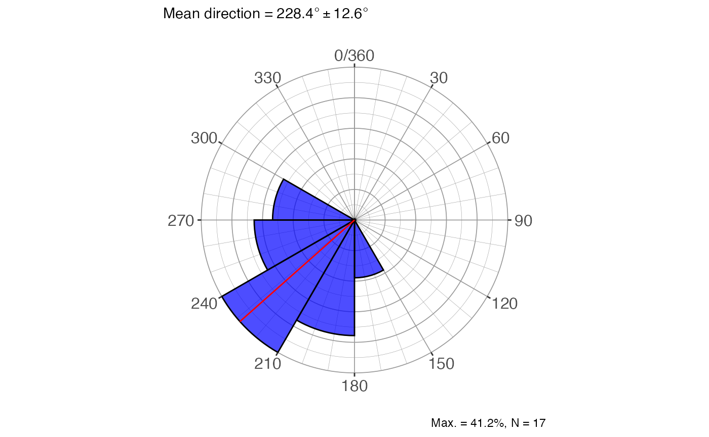

``` r

rose_diag_circ(carolina, width = 10, dir = 0)
```

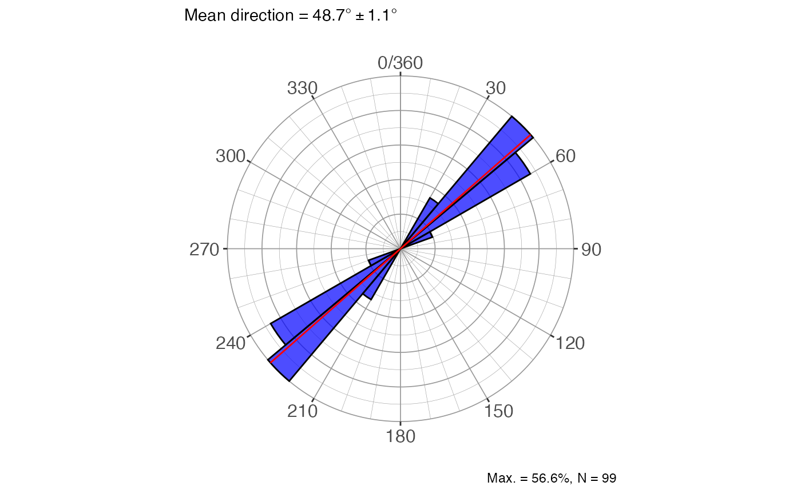

### Two-sample test

This is the homologous to the 2-sample *t-test*, where two sets of data
are compared to determine if they have the same mean, but in this case
it refers to the mean direction. The function is
`dir_2sample_test_circ`, with the usual arguments with the addition of a
second vector of measurements. The test is an *F-test*, comparing the
critical value with the estimated value. The result gives the
*F-statistics*, the p-value and an interpretation.

``` r

y = c(
  225,
  208,
  172,
  198,
  204,
  183,
  190,
  212,
  247,
  127,
  167,
  234,
  217,
  192,
  212,
  171,
  169,
  210,
  245,
  222,
  185,
  227,
  193,
  178,
  187,
  182,
  194,
  217,
  168,
  211,
  234,
  204,
  221,
  198,
  261,
  228,
  146,
  201,
  146,
  231
)
dir_2sample_test_circ(x, y, dir = 1, conf.level = 0.95)
#> $f
#> [1] 11.45
#> 
#> $fcrit
#> [1] 4.02
#> 
#> $df1
#> [1] 1
#> 
#> $df2
#> [1] 55
#> 
#> $p_value
#> [1] 0.00133
#> 
#> $interpretation
#> [1] "Reject H0 and conclude that the two samples could not come from the same population with the same mean direction"
```

Other functions are available from other packages like `Directional`,
`circular` and `CircStats`, including tests for randomness, uniformity,
and multiple samples, but they are not included in this vignette.

## Spherical data

Spherical data refers to data represented by two vectors: dip direction
(strike, trend) and dip angle (plunge). All of the statistics and test
done in circular data are extended to spherical data, so the functions
just change the last part of the name. The spherical data includes
directed (vector) and undirected (axial) data, with axial data being
either bi-polar or girdle. By default, the functions assume that the
data is directed (vector, trend/plunge), but with the `type` argument
should be specified if otherwise. The interpretation of the results
changes depending on the type of data, so it is important to specify it
correctly.

### Basic stats

The main function, `dir_stats_spher`, has the same arguments as
`dir_stats_circ` but with the addition of the `plunge` vector for the
plunge/dip angles, as well as the `type` argument for the type of data
being provided. The output are the eigenvalues and eigenvectors, the
orientation matrix, the trend/plunge and dir/dip of the mean directions,
the summary for directed (vector) and undirected (axial) data, depending
on the case, and the summary for Point-Girdle-Randon characterization.
Additionally, the plots for eigenvalues, pgr characterization, and the
data plotted in a stereonet with the chosen summary stats.

``` r

trds = c(12, 18, 22, 15, 10, 20)
plgs = c(42, 40, 48, 30, 42, 30)
dir_stats_spher(trds, plgs, conf.level = 0.95, type = 'line')
#> $eigen_values
#>            V1     V2     V3
#> lambda 5.9020 0.0799 0.0181
#> S      0.9837 0.0133 0.0030
#> 
#> $eigen_vectors
#>          V1         V2          V3
#> x 0.7491359 -0.5903778 -0.30041565
#> y 0.2167973 -0.2100226  0.95335692
#> z 0.6259348  0.7793232  0.02934318
#> 
#> $orientation_matrix
#>           [,1]      [,2]      [,3]
#> [1,] 3.3417213 0.9632761 2.7306143
#> [2,] 0.9632761 0.2973670 0.7883442
#> [3,] 2.7306143 0.7883442 2.3609117
#> 
#> $trend_plunge
#>        V1     V2     V3
#> trd 16.14 199.58 107.49
#> plg 38.75  51.20   1.68
#> 
#> $dir_dip
#>         V1    V2     V3
#> dir 196.14 19.58 287.49
#> dip  51.25 38.80  88.32
#> 
#> $vector_stats
#> # A tibble: 1 × 13
#>     trd   plg strike   dir   dip     R  Rbar kappa  cone     N     x     y     z
#>   <dbl> <dbl>  <dbl> <dbl> <dbl> <dbl> <dbl> <dbl> <dbl> <int> <dbl> <dbl> <dbl>
#> 1  16.2  38.7   106.  196.  51.3  5.95 0.992  84.6  6.68     6 0.749 0.217 0.626
#> 
#> $axis_stats_watson
#> # A tibble: 1 × 5
#>   V1_cone V2_cone V3_cone kappa_bipolar kappa_girdle
#>     <dbl>   <dbl>   <dbl>         <dbl>        <dbl>
#> 1    5.27    4.77       0          61.6        -166.
#> 
#> $axis_stats_aniso
#>                       V1      V2       V3
#> bingham kappa      0.000 -37.558 -165.838
#> watson max ellipse 6.737  39.133   38.980
#> watson min ellipse 3.178   5.900    2.860
#> 
#> $PointGirdleRandom
#> # A tibble: 1 × 13
#>       P      G       R     B     I     D     K     C s1.s2 s1.s3 s2.s3    r1
#>   <dbl>  <dbl>   <dbl> <dbl> <dbl> <dbl> <dbl> <dbl> <dbl> <dbl> <dbl> <dbl>
#> 1 0.970 0.0206 0.00904 0.991  4.76 0.976  2.90  5.79  73.9  326.  4.42  1.49
#> # ℹ 1 more variable: r2 <dbl>
#> 
#> $eigenplot
```

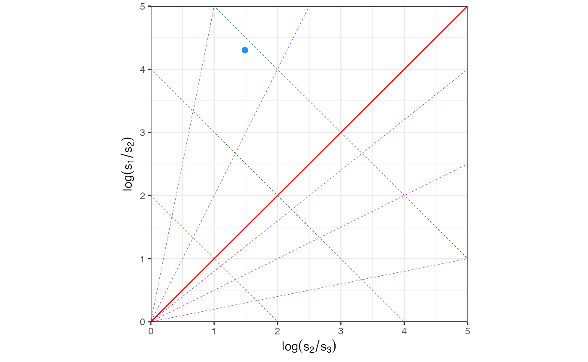

    #> 
    #> $pgrplot

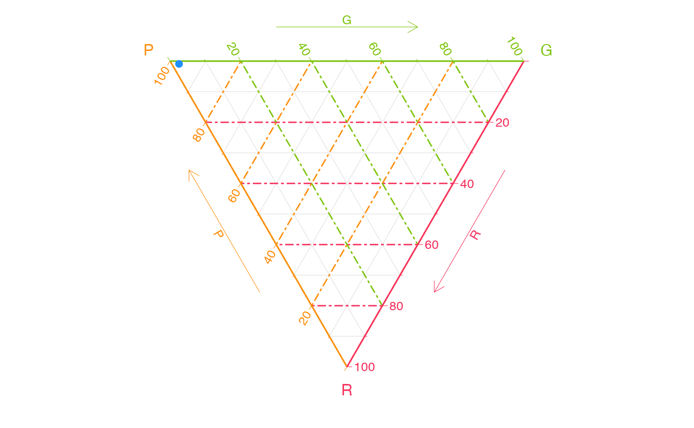

    #> 
    #> $stereoplot

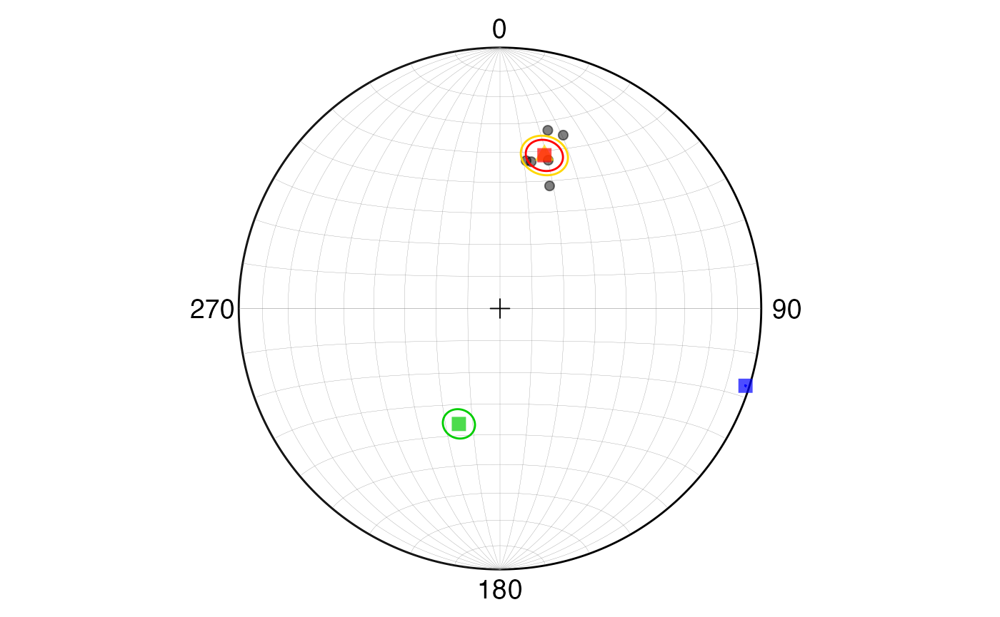

Data can be provided in a data frame, like in the following example,
where the data is from a set of measurements of axial data (undirected,
bi-polar) from a geological formation. The data is available in the
package as a csv file:

``` r

csv_path <- system.file("spherical_data_ax_bp.csv", package = "GMisc")
df <- utils::read.csv(csv_path)
head(df)
#>   dip_direction dip
#> 1            65  50
#> 2            75  53
#> 3           233  85
#> 4            39  82
#> 5            53  82
#> 6            58  66
```

``` r

res2 <- dir_stats_spher(
  dip_direction,
  dip,
  data = df,
  conf.level = 0.90,
  type = "dir"
)
res2$axis_stats_watson
#> # A tibble: 1 × 5
#>   V1_cone V2_cone V3_cone kappa_bipolar kappa_girdle
#>     <dbl>   <dbl>   <dbl>         <dbl>        <dbl>
#> 1    2.93    2.30       0          12.6        -14.1
res2$stereoplot
```

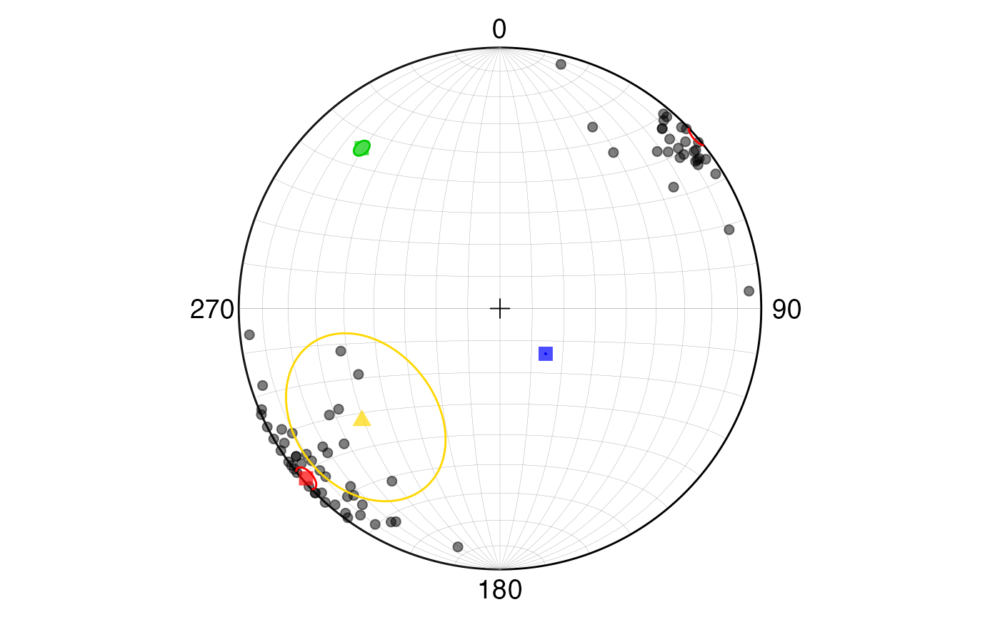

### Rose diagram

For the spherical case the rose diagram function is `rose_diag_spher`,
with arguments similar to `dir_stats_spher` and outputs several rose
diagrams: for the strike, dip direction, dip angle, trend, and plunge.
By default shows all of them but the desired output can be selected with
the `show` argument, selecting one or more of: “strike”, “dir”, “dip”,
“trend”, “plunge”.

``` r

dip.dir = c(12, 18, 22, 15, 10, 20)
strike = d2s(dip.dir)
dip = c(42, 40, 48, 30, 42, 30)
rose_diag_spher(
  strike,
  dip,
  width1 = 30,
  type = 'dir',
  show = c("strike", "dip")
)
#> $strike
```

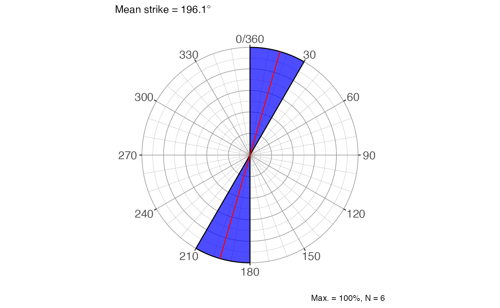

    #> 
    #> $dip

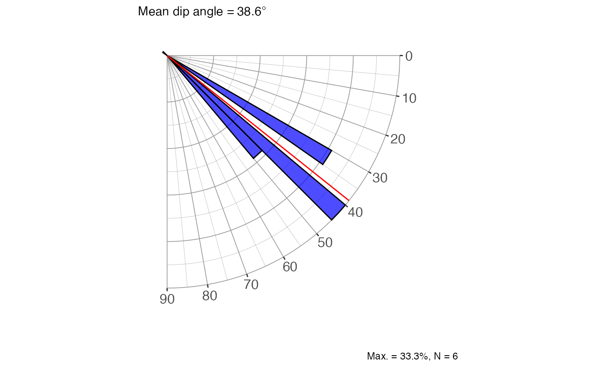

### Multiple-sample test

Similar as the circular case but for two or more sets of spherical data.
There are two main functions: `dir_aov_spher_vec` for the vector
(directed) case, and `dir_aov_spher_ax` for the axial (undirected) case,
so previous knowledge of the structure of the data must be available. In
general both functions output the result of the statistical test with
its interpretation for the specific case, group statistics, and a plot
of the data in a stereonet with the mean directions for each group, and
,if the null hypothesis is not rejected, the common mean is also
displayed.

``` r

set.seed(123)
trds <- c(runif(10, 50, 70), runif(10, 70, 90))
plgs <- c(runif(10, 20, 40), runif(10, 30, 50))
grps <- rep(c("A", "B"), each = 10)
res <- dir_aov_spher_vec(trds, plgs, grps)
res
#> $statement
#> [1] "Mean direction differs between samples"
#> 
#> $vector_g
#> # A tibble: 2 × 9
#>   grp       N     R  Rbar kappa   sigc   trd   plg  cone
#>   <chr> <int> <dbl> <dbl> <dbl>  <dbl> <dbl> <dbl> <dbl>
#> 1 A        10  9.93 0.993 120.  0.0369  61.5  32.4  3.66
#> 2 B        10  9.90 0.990  83.5 0.0443  80.2  41.0  4.40
#> 
#> $vector_res
#> # A tibble: 1 × 3
#>      Nr    df  p.value
#>   <dbl> <dbl>    <dbl>
#> 1  54.0     2 1.87e-12
#> 
#> $stereoplot
```


More functions are available from the `Directional` package, including
tests for randomness, uniformity, and multiple samples, but they are not
included in this vignette. For the spherical case it needs the data in
unit vectors (x, y, z) which can be obtained from `SphToCartD` function.

### Stereonets

This is a representation of data used typically in structural geology
and other branches of geology. It can be useful to visualize the
distribution of the data. It has the most use with spherical data
although circular data can be plotted with a plunge/dip angle of zero.

The main function is `ggstereo`, which creates a blank stereonet (by
default equal area - Schmidt), and then the data can be added with the
different functions depending on the type of data and the desired
representation.

#### Lines

To draw lines (points, like poles) we need to get the coordinates of the
points in the stereonet, which can be obtained with the `StCoordLineD`
function. It tkes the trends and plunges and outputs a data frame with
the coordinates for plotting. The points can be added to the stereonet
with `geom_point`.

``` r

set.seed(4101)
trds <- runif(min = 30, max = 80, n = 20)
plgs <- runif(min = 10, max = 60, n = 20)
pts <- StCoordLineD(trds, plgs)

ggstereo() +
  geom_point(aes(xp, yp), pts, col = 'red')
```

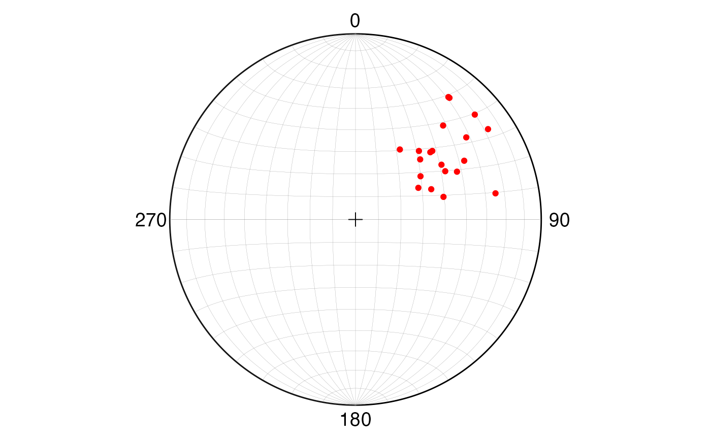

#### Planes (Great circles)

To draw planes (great circles) we need to get the coordinates of the
points in the stereonet, which can be obtained with the `GreatCircleD`
function. It takes the strike (right-hand rule) and dip and outputs a
data frame with the coordinates for plotting. The planes can be added to
the stereonet with `geom_path`. The function works for 1 plane at a
time, so if more than one plane is needed it can be used with `map2` and
`list_rbind` to get the coordinates for all the planes in a single data
frame.

``` r

strike = 240
dip = 30
plane <- GreatCircleD(strike, dip)

ggstereo() +
  geom_path(aes(xp, yp), plane, col = 'steelblue')
```


``` r

set.seed(4101)
strike <- runif(min = 30, max = 80, n = 10)
dip <- runif(min = 40, max = 60, n = 10)
planes <- map2(strike, dip, ~ GreatCircleD(.x, .y)) |>
  list_rbind(names_to = "plane_id")

ggstereo() +
  geom_path(aes(xp, yp, group = plane_id), planes, col = 'steelblue')
```

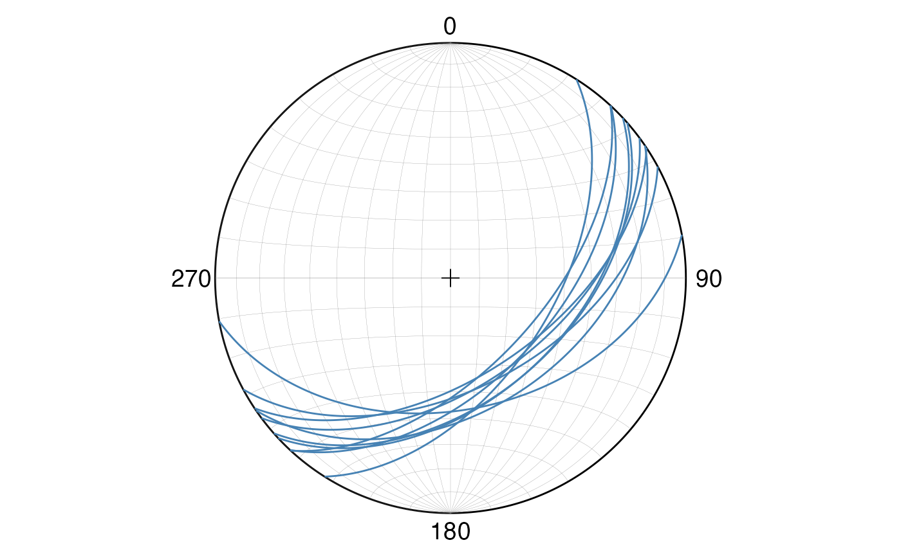

##### Cone angle (Small circles)

To draw small circles we need to get the coordinates of the points in
the stereonet, which can be obtained with the `SmallCircleD` function.
It takes the trend and plunge of the center of the small circle, and the
cone angle. Since the small circle can wrap around the edge of the
stereonet two paths are generated and they need to be combined. The
planes can be added to the stereonet with `geom_path`.

``` r

pt = StCoordLineD(trd = 230, plg = 40)
sc = SmallCircleD(trda = 230, plga = 40, coneAngle = 20, closed = TRUE) |>
  list_rbind(names_to = "sc_id")

ggstereo() +
  geom_point(aes(xp, yp), pt, col = 'red') +
  geom_path(aes(xp, yp, group = sc_id), sc, col = 'steelblue')
```

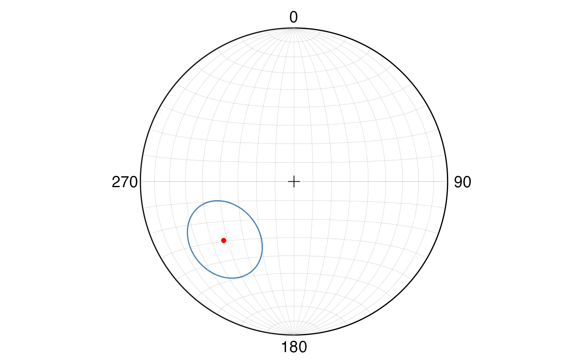

##### Mean plane/trend and principal stresses

The mean plane/trend and principal stresses can be obtained and plotted
directly with `dir_stats_spher`. From these results the desired
information can be obtained and plotted as shown before.

``` r

dirs = c(12, 18, 22, 15, 10, 20)
dips = c(42, 40, 48, 30, 42, 30)
res <- dir_stats_spher(trds, plgs, conf.level = 0.95, type = 'dir')
res$stereoplot
```

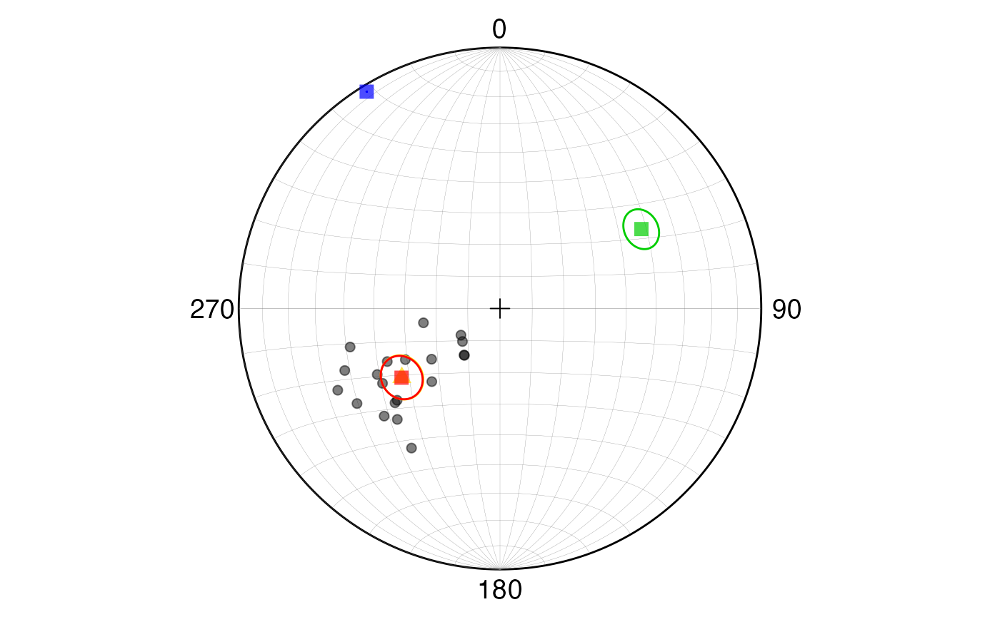

## Extras

There are some extra functions that help dealing with directional data,
some of which were used during the examples.

- `d2s`: Converts dip direction to strike direction.
- `s2d`: Converts strike direction to dip direction.
- `rads`: Converts degrees to radians.
- `degs`: Converts radians to degrees.
- `StCoordLineD`: Converts trend and plunge to stereonet coordinates.
- `GreatCircleD`: Converts strike and dip to stereonet coordinates for
  great circles.
- `SmallCircleD`: Converts trend and plunge with the respective angle to
  stereonet coordinates for small circles.
- `SphToCartD`: Converts spherical coordinates to Cartesian coordinates
  (unit vectors).
- `CartToSphD`: Converts Cartesian coordinates (unit vectors) to
  spherical coordinates.
- `Pole`: Returns either the strike and dip of a plane given its pole,
  or the trend and plunge of a pole given its plane (right-hand rule
  convention), the input data must be in **radians**.

## Shinyapp

A shinyapp using these functions can be accessed at
<https://maximiliano-01.shinyapps.io/directional/>.
