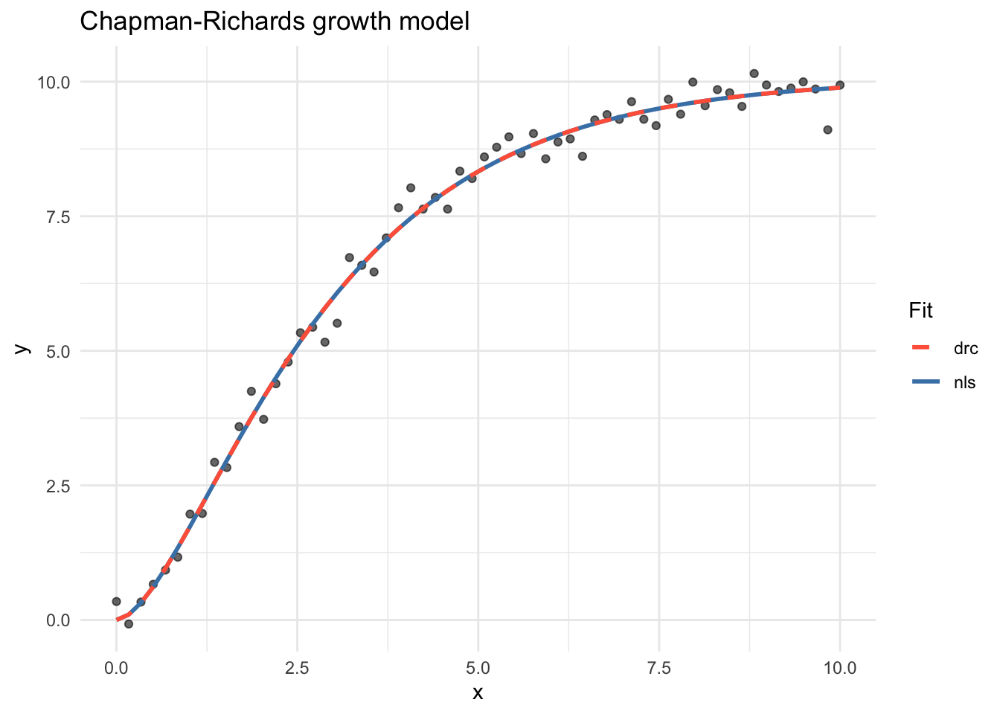
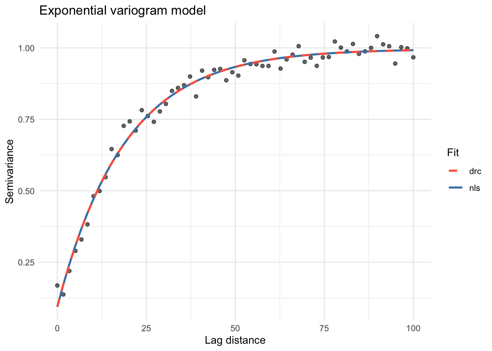
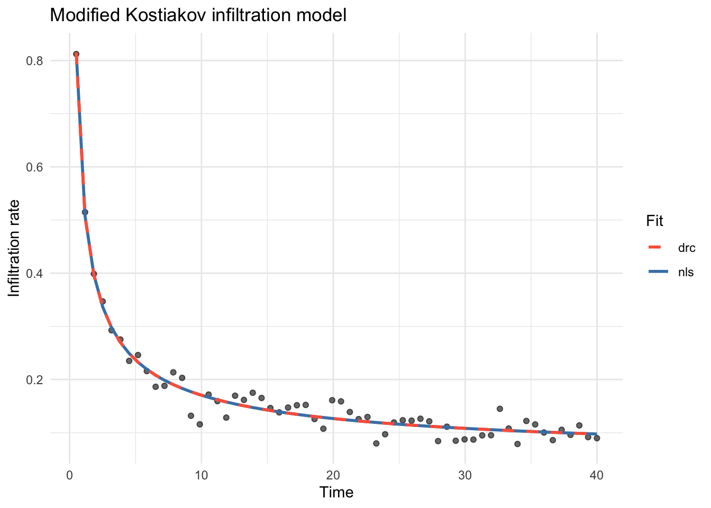

# Non-linear and self-starting functions

``` r

library(GMisc)
library(drc)
library(ggplot2)
```

## Introduction

The `GMisc` package provides a collection of non-linear model functions
together with self-starting routines for both
[`nls()`](https://rdrr.io/r/stats/nls.html) (base R) and
[`drc::drm()`](https://rdrr.io/pkg/drc/man/drm.html). Self- starters
automatically derive sensible initial parameter values from the data,
removing the need to supply starting values manually and reducing the
risk of convergence failures.

Each model is available in three forms:

- **`*.fun()`** — the bare mathematical function.
- **`SS*()`** — a `selfStart` object for use with
  [`nls()`](https://rdrr.io/r/stats/nls.html).
- **`DRC*()`** — a `drcMean` object for use with
  [`drc::drm()`](https://rdrr.io/pkg/drc/man/drm.html).

------------------------------------------------------------------------

## Available models

| Model | Equation | Parameters | `nls` self-starter | `drc` self-starter |
|----|----|----|----|----|
| Chapman-Richards | y = a(1 - e^{-bx})^c | a, b, c | [`SSchaprich()`](https://maxgav13.github.io/GMisc/reference/chaprich.md) | [`DRCchaprich()`](https://maxgav13.github.io/GMisc/reference/chaprich.md) |
| Exp. with inverse predictor (Type 3) | y = a e^{b/x} | a, b | [`SSexp3()`](https://maxgav13.github.io/GMisc/reference/exp3.md) | [`DRCexp3()`](https://maxgav13.github.io/GMisc/reference/exp3.md) |
| Negative exponential | y = a + b e^{cx} | a, b, c | [`SSexpneg()`](https://maxgav13.github.io/GMisc/reference/expneg.md) | [`DRCexpneg()`](https://maxgav13.github.io/GMisc/reference/expneg.md) |
| Two-asymptote exponential | y = a e^{cx} + b(1 - e^{cx}) | a, b, c | [`SSexpneg2()`](https://maxgav13.github.io/GMisc/reference/expneg2.md) | [`DRCexpneg2()`](https://maxgav13.github.io/GMisc/reference/expneg2.md) |
| Exponential variogram | y = \text{nug} + \text{psill}(1 - e^{-x/\text{range}}) | nug, psill, range | [`SSvarexp()`](https://maxgav13.github.io/GMisc/reference/varexp.md) | [`DRCvarexp()`](https://maxgav13.github.io/GMisc/reference/varexp.md) |
| Gaussian variogram | y = \text{nug} + \text{psill}(1 - e^{-(x/\text{range})^2}) | nug, psill, range | [`SSvargauss()`](https://maxgav13.github.io/GMisc/reference/vargauss.md) | [`DRCvargauss()`](https://maxgav13.github.io/GMisc/reference/vargauss.md) |
| Spherical variogram | y = \text{nug} + \text{psill}\left(\frac{3}{2}\frac{x}{r} - \frac{1}{2}\left(\frac{x}{r}\right)^3\right),\\ x \le r | nug, psill, range | [`SSvarsph()`](https://maxgav13.github.io/GMisc/reference/varsph.md) | [`DRCvarsph()`](https://maxgav13.github.io/GMisc/reference/varsph.md) |
| Inverse polynomial (1st order) | y = \dfrac{x}{a + bx} | a, b | [`SSinvpoly1()`](https://maxgav13.github.io/GMisc/reference/invpoly1.md) | [`DRCinvpoly1()`](https://maxgav13.github.io/GMisc/reference/invpoly1.md) |
| Inverse polynomial (2nd order) | y = \dfrac{x}{a + bx + cx^2} | a, b, c | [`SSinvpoly2()`](https://maxgav13.github.io/GMisc/reference/invpoly2.md) | [`DRCinvpoly2()`](https://maxgav13.github.io/GMisc/reference/invpoly2.md) |
| Inverse polynomial (3rd order) | y = \dfrac{x}{a + bx + cx^2 + dx^3} | a, b, c, d | [`SSinvpoly3()`](https://maxgav13.github.io/GMisc/reference/invpoly3.md) | [`DRCinvpoly3()`](https://maxgav13.github.io/GMisc/reference/invpoly3.md) |
| Modified Kostiakov | y = \alpha x^{\beta} + f_c | \alpha, \beta, f_c | [`SSkostmod()`](https://maxgav13.github.io/GMisc/reference/kostmod.md) | [`DRCkostmod()`](https://maxgav13.github.io/GMisc/reference/kostmod.md) |

------------------------------------------------------------------------

## Examples

### 1. Chapman-Richards growth model

The Chapman-Richards model describes sigmoidal growth towards an upper
asymptote a:

y = a \left(1 - e^{-bx}\right)^c

``` r

set.seed(42)
x <- seq(0, 10, length.out = 60)
y <- chaprich.fun(x, a = 10, b = 0.5, c = 2) + rnorm(60, sd = 0.25)
df <- data.frame(x = x, y = y)
```

**Fit with [`nls()`](https://rdrr.io/r/stats/nls.html)**

``` r

mod_nls <- nls(y ~ SSchaprich(x, a, b, c), data = df)
summary(mod_nls)
#> 
#> Formula: y ~ SSchaprich(x, a, b, c)
#> 
#> Parameters:
#>   Estimate Std. Error t value Pr(>|t|)    
#> a 10.06996    0.10643   94.62   <2e-16 ***
#> b  0.45860    0.02496   18.38   <2e-16 ***
#> c  1.77995    0.11407   15.60   <2e-16 ***
#> ---
#> Signif. codes:  0 '***' 0.001 '**' 0.01 '*' 0.05 '.' 0.1 ' ' 1
#> 
#> Residual standard error: 0.2832 on 57 degrees of freedom
#> 
#> Number of iterations to convergence: 5 
#> Achieved convergence tolerance: 2.883e-07
```

**Fit with [`drc::drm()`](https://rdrr.io/pkg/drc/man/drm.html)**

``` r

mod_drc <- drm(y ~ x, data = df, fct = DRCchaprich())
summary(mod_drc)
#> 
#> Model fitted: Chapman-Richards growth model
#> 
#> Parameter estimates:
#> 
#>                Estimate Std. Error t-value   p-value    
#> a:(Intercept) 10.069934   0.105530  95.422 < 2.2e-16 ***
#> b:(Intercept)  0.458611   0.024683  18.580 < 2.2e-16 ***
#> c:(Intercept)  1.779977   0.113123  15.735 < 2.2e-16 ***
#> ---
#> Signif. codes:  0 '***' 0.001 '**' 0.01 '*' 0.05 '.' 0.1 ' ' 1
#> 
#> Residual standard error:
#> 
#>  0.2832407 (57 degrees of freedom)
```

**Plot**

``` r

df$fit_nls <- predict(mod_nls)
df$fit_drc <- predict(mod_drc)

ggplot(df, aes(x, y)) +
  geom_point(alpha = 0.6) +
  geom_line(aes(y = fit_nls, colour = "nls"), linewidth = 1) +
  geom_line(
    aes(y = fit_drc, colour = "drc"),
    linewidth = 1,
    linetype = "dashed"
  ) +
  scale_colour_manual(values = c(nls = "steelblue", drc = "tomato")) +
  labs(
    title = "Chapman-Richards growth model",
    x = "x",
    y = "y",
    colour = "Fit"
  ) +
  theme_minimal()
```



------------------------------------------------------------------------

### 2. Exponential variogram model

The exponential variogram is widely used in geostatistics to model
spatial autocorrelation. It approaches the sill asymptotically:

\gamma(x) = \text{nug} + \text{psill}\left(1 - e^{-x /
\text{range}}\right)

``` r

set.seed(7)
x <- seq(0, 100, length.out = 60)
y <- varexp.fun(x, nug = 0.1, psill = 0.9, range = 20) + rnorm(60, sd = 0.03)
df2 <- data.frame(x = x, y = y)
```

**Fit with [`nls()`](https://rdrr.io/r/stats/nls.html)**

``` r

mod_nls2 <- nls(y ~ SSvarexp(x, nug, psill, range), data = df2)
summary(mod_nls2)
#> 
#> Formula: y ~ SSvarexp(x, nug, psill, range)
#> 
#> Parameters:
#>       Estimate Std. Error t value Pr(>|t|)    
#> nug    0.09419    0.01697   5.551 7.71e-07 ***
#> psill  0.90220    0.01624  55.569  < 2e-16 ***
#> range 18.76848    0.72081  26.038  < 2e-16 ***
#> ---
#> Signif. codes:  0 '***' 0.001 '**' 0.01 '*' 0.05 '.' 0.1 ' ' 1
#> 
#> Residual standard error: 0.02931 on 57 degrees of freedom
#> 
#> Number of iterations to convergence: 4 
#> Achieved convergence tolerance: 1.691e-07
```

**Fit with [`drc::drm()`](https://rdrr.io/pkg/drc/man/drm.html)**

``` r

mod_drc2 <- drm(y ~ x, data = df2, fct = DRCvarexp())
summary(mod_drc2)
#> 
#> Model fitted: Exponential variogram model
#> 
#> Parameter estimates:
#> 
#>                    Estimate Std. Error t-value   p-value    
#> nug:(Intercept)    0.094185   0.016996  5.5417 7.992e-07 ***
#> psill:(Intercept)  0.902198   0.016245 55.5360 < 2.2e-16 ***
#> range:(Intercept) 18.768462   0.723650 25.9358 < 2.2e-16 ***
#> ---
#> Signif. codes:  0 '***' 0.001 '**' 0.01 '*' 0.05 '.' 0.1 ' ' 1
#> 
#> Residual standard error:
#> 
#>  0.02931391 (57 degrees of freedom)
```

**Plot**

``` r

df2$fit_nls <- predict(mod_nls2)
df2$fit_drc <- predict(mod_drc2)

ggplot(df2, aes(x, y)) +
  geom_point(alpha = 0.6) +
  geom_line(aes(y = fit_nls, colour = "nls"), linewidth = 1) +
  geom_line(
    aes(y = fit_drc, colour = "drc"),
    linewidth = 1,
    linetype = "dashed"
  ) +
  scale_colour_manual(values = c(nls = "steelblue", drc = "tomato")) +
  labs(
    title = "Exponential variogram model",
    x = "Lag distance",
    y = "Semivariance",
    colour = "Fit"
  ) +
  theme_minimal()
```



------------------------------------------------------------------------

### 3. Modified Kostiakov infiltration model

The Modified Kostiakov model describes infiltration rate as a power-law
decay with an additive constant representing the steady-state rate f_c:

y = \alpha\\ x^{\beta} + f_c

``` r

set.seed(99)
x <- seq(0.5, 40, length.out = 60)
y <- kostmod.fun(x, alfa = 0.5, beta = -0.6, fc = 0.05) + rnorm(60, sd = 0.02)
df3 <- data.frame(x = x, y = y)
```

**Fit with [`nls()`](https://rdrr.io/r/stats/nls.html)**

``` r

mod_nls3 <- nls(y ~ SSkostmod(x, alfa, beta, fc), data = df3)
summary(mod_nls3)
#> 
#> Formula: y ~ SSkostmod(x, alfa, beta, fc)
#> 
#> Parameters:
#>      Estimate Std. Error t value Pr(>|t|)    
#> alfa  0.51203    0.01563  32.768  < 2e-16 ***
#> beta -0.59698    0.03182 -18.764  < 2e-16 ***
#> fc    0.04094    0.01089   3.758 0.000405 ***
#> ---
#> Signif. codes:  0 '***' 0.001 '**' 0.01 '*' 0.05 '.' 0.1 ' ' 1
#> 
#> Residual standard error: 0.01957 on 57 degrees of freedom
#> 
#> Number of iterations to convergence: 4 
#> Achieved convergence tolerance: 1.916e-06
```

**Fit with [`drc::drm()`](https://rdrr.io/pkg/drc/man/drm.html)**

``` r

mod_drc3 <- drm(y ~ x, data = df3, fct = DRCkostmod())
summary(mod_drc3)
#> 
#> Model fitted: Modified Kostiakov infiltration model
#> 
#> Parameter estimates:
#> 
#>                   Estimate Std. Error  t-value   p-value    
#> alfa:(Intercept)  0.512022   0.015606  32.8097 < 2.2e-16 ***
#> beta:(Intercept) -0.596995   0.031731 -18.8141 < 2.2e-16 ***
#> fc:(Intercept)    0.040941   0.010866   3.7676 0.0003927 ***
#> ---
#> Signif. codes:  0 '***' 0.001 '**' 0.01 '*' 0.05 '.' 0.1 ' ' 1
#> 
#> Residual standard error:
#> 
#>  0.01956542 (57 degrees of freedom)
```

**Plot**

``` r

df3$fit_nls <- predict(mod_nls3)
df3$fit_drc <- predict(mod_drc3)

ggplot(df3, aes(x, y)) +
  geom_point(alpha = 0.6) +
  geom_line(aes(y = fit_nls, colour = "nls"), linewidth = 1) +
  geom_line(
    aes(y = fit_drc, colour = "drc"),
    linewidth = 1,
    linetype = "dashed"
  ) +
  scale_colour_manual(values = c(nls = "steelblue", drc = "tomato")) +
  labs(
    title = "Modified Kostiakov infiltration model",
    x = "Time",
    y = "Infiltration rate",
    colour = "Fit"
  ) +
  theme_minimal()
```


