# Soil Mechanics

This document highlights some functions of the `GMisc` package related
to soil mechanics problems.

## Bearing capacity

The idea here is to provide a function that solves the bearing capacity
equation for different types of footings, giving as a result the
ultimate ($`q_u`$) and allowable bearing capacity ($`q_a`$):

``` math
q_u = 0.5 \ B \gamma N_\gamma s_\gamma d_\gamma + D \gamma \left(N_q-1\right) s_q d_q + c N_c s_c d_c
```

``` math
q_a = \frac{q_u}{FS}
```

where $`B`$ is the width in meters, $`D`$ is the embedment depth in
meters, $`FS`$ is the desired factor of safety, $`c`$ is the cohesion in
kPa (referred as `tau0` in the function), $`\gamma`$ is the unit weight
in $`kN/m^3`$, and the rest of the parameters are correction factors
dependent on these input values, the internal friction angle $`\phi`$,
the type of footing (“strip”, “square”, “rectangular”,“circular”), and
the depth to the water level.

The function that solves the above equation is `bearing_capacity`, with
the mentioned arguments but specifying the wet/moist unit weight,
saturated unit weight for their respective use. The function outputs a
table for $`q_u`$ and for $`q_a`$ and graph for the results.

The `B` and `D` parameters can be vectors for multiple cases comparisons
or single values for a single case estimate. If `FS = 1` then the
allowable and ultimate bearing capacities are the same ($`q_a = q_u`$).

Different scenarios can be analyzed:

- For a total stress analysis (TSA) in a cohesive soil (plastic silts
  and clays) set the friction angle equal to zero (`phi = 0`) and the
  cohesion equal to the undrained shear strength (`tau0 = Su`).
- For an effective stress analysis (ESA) in a cohesive soil use the
  effective friction angle ($`\phi'`$) and effective cohesion ($`c'`$).
- For a coarse-grained soil (gravels, sands, and non-plastic silts)
  usually TSA = ESA, and the friction angle and cohesion should be used,
  and if the material has no-cohesion then set cohesion equal to zero
  (`tau0 = 0`)

Also different methods can be used to calculate the bearing capacity
factors ($`N_\gamma`$, $`N_q`$, and $`N_c`$), such as “Vesic” (default),
“Terzaghi”, “Meyerhof”, “Hansen”, “Michalowski” or “Davis & Booker”.
Additionally the type of failure case can be specified and it can be
either “general” or “local”.

We can define a set of parameters to use in different examples as
follows:

``` r

B = seq(0.5, 2, 0.25)
D = seq(0, 2, 0.25)
L = NULL
gamma.h = 15.5
gamma.s = 18.5
tau0 = 10
phi = 30
FS = 3
wl = 1
```

The first example uses the default “square” footing:

``` r

bearing_capacity(B, D, L, gamma.h, gamma.s, tau0, phi, wl, FS)
```

    ## $qu
    ## # A tibble: 9 × 8
    ##   `D/B` `0.5` `0.75`   `1` `1.25` `1.5` `1.75`   `2`
    ##   <dbl> <dbl>  <dbl> <dbl>  <dbl> <dbl>  <dbl> <dbl>
    ## 1  0     414.   440.  466.   480.  495.   510.  524.
    ## 2  0.25  595.   596.  598.   605.  615.   626   638.
    ## 3  0.5   807.   762.  746.   743.  745.   751.  759.
    ## 4  0.75  929.   947.  909.   892.  886.   885.  888.
    ## 5  1    1084.  1055. 1088.  1054. 1036.  1028. 1025 
    ## 6  1.25 1185.  1158. 1138.  1179. 1150.  1134. 1126.
    ## 7  1.5  1281.  1256. 1237.  1222. 1271.  1246. 1231.
    ## 8  1.75 1375.  1352. 1333.  1318. 1307.  1362. 1340.
    ## 9  2    1467.  1446. 1428.  1413. 1402.  1393. 1453.
    ## 
    ## $qa
    ## # A tibble: 9 × 8
    ##   `D/B` `0.5` `0.75`   `1` `1.25` `1.5` `1.75`   `2`
    ##   <dbl> <dbl>  <dbl> <dbl>  <dbl> <dbl>  <dbl> <dbl>
    ## 1  0     138.   147.  155.   160.  165.   170.  175.
    ## 2  0.25  202.   203.  203.   206.  209.   213.  217.
    ## 3  0.5   277.   262.  256.   255.  256.   258.  261.
    ## 4  0.75  321.   327.  315.   309.  307.   307.  308.
    ## 5  1     377.   367.  378.   367.  361.   358.  357.
    ## 6  1.25  413.   404.  397.   411.  401.   396.  393.
    ## 7  1.5   447.   439.  432.   427.  443.   435.  430.
    ## 8  1.75  480.   473.  466.   461.  458.   476.  469.
    ## 9  2     513.   506.  500.   495.  491.   488.  509.
    ## 
    ## $Plot


The second example uses the a “strip” footing:

``` r

bearing_capacity(
  B,
  D,
  L,
  gamma.h,
  gamma.s,
  tau0,
  phi,
  wl,
  FS,
  footing = "strip"
)
```

    ## $qu
    ## # A tibble: 9 × 8
    ##   `D/B` `0.5` `0.75`   `1` `1.25` `1.5` `1.75`   `2`
    ##   <dbl> <dbl>  <dbl> <dbl>  <dbl> <dbl>  <dbl> <dbl>
    ## 1  0     388.   432.  475.   499.  524.   548.  572.
    ## 2  0.25  515.   539.  553.   571.  592.   613.  636.
    ## 3  0.5   661.   640.  641.   651.  667.   684.  704.
    ## 4  0.75  727.   754.  738.   739.  748.   761.  777.
    ## 5  1     816.   809.  846.   835.  835.   843.  854.
    ## 6  1.25  882.   876.  875.   919.  912.   914.  921.
    ## 7  1.5   944.   940.  940.   943.  992.   988.  991.
    ## 8  1.75 1005.  1002. 1003.  1006. 1012.  1065. 1063.
    ## 9  2    1064.  1063. 1064.  1068. 1073.  1081. 1138.
    ## 
    ## $qa
    ## # A tibble: 9 × 8
    ##   `D/B` `0.5` `0.75`   `1` `1.25` `1.5` `1.75`   `2`
    ##   <dbl> <dbl>  <dbl> <dbl>  <dbl> <dbl>  <dbl> <dbl>
    ## 1  0     129.   144.  158.   166.  175.   183.  191.
    ## 2  0.25  176.   183.  188.   194.  201.   208.  216.
    ## 3  0.5   228.   221.  221.   225.  230.   236.  242.
    ## 4  0.75  254.   263.  258.   258.  261.   265.  270.
    ## 5  1     288.   285.  297.   294.  294.   296.  300.
    ## 6  1.25  312.   310.  309.   324.  322.   322.  325.
    ## 7  1.5   335.   333.  333.   334.  350.   349.  350.
    ## 8  1.75  357.   356.  356.   357.  359.   377.  376.
    ## 9  2     379.   379.  379.   380.  382.   384.  404.
    ## 
    ## $Plot

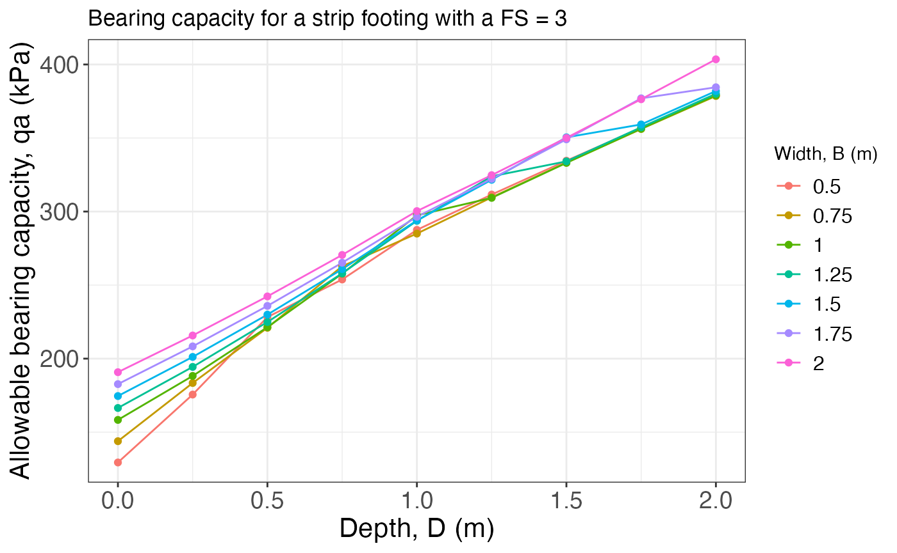

And the last example uses a “rectangular” footing, where it is needed to
define the `L` argument (the length of the footing in meters):

``` r

bearing_capacity(
  B,
  D,
  L = 3,
  gamma.h,
  gamma.s,
  tau0,
  phi,
  wl,
  FS,
  footing = "rectangular"
)
```

    ## $qu
    ## # A tibble: 9 × 8
    ##   `D/B` `0.5` `0.75`   `1` `1.25` `1.5` `1.75`   `2`
    ##   <dbl> <dbl>  <dbl> <dbl>  <dbl> <dbl>  <dbl> <dbl>
    ## 1  0     397.   434.  472.   493.  514.   535.  556.
    ## 2  0.25  542.   558.  568.   583.  600.   618.  636.
    ## 3  0.5   710.   680.  676.   682.  693.   707.  722.
    ## 4  0.75  794.   818.  795.   790.  794.   802.  814.
    ## 5  1     906.   891.  926.   908.  902.   904.  911.
    ## 6  1.25  983.   970.  962.  1006.  991.   987.  989.
    ## 7  1.5  1056.  1046. 1039.  1036. 1085.  1074. 1071.
    ## 8  1.75 1128.  1119. 1113.  1110. 1110.  1164. 1155.
    ## 9  2    1198.  1191. 1186.  1183. 1183.  1185. 1243.
    ## 
    ## $qa
    ## # A tibble: 9 × 8
    ##   `D/B` `0.5` `0.75`   `1` `1.25` `1.5` `1.75`   `2`
    ##   <dbl> <dbl>  <dbl> <dbl>  <dbl> <dbl>  <dbl> <dbl>
    ## 1  0     132.   145.  157.   164.  171.   178.  185.
    ## 2  0.25  184.   190.  193.   198.  204.   210.  216 
    ## 3  0.5   244.   235.  233.   235.  239.   243.  248.
    ## 4  0.75  276.   284.  277.   275   276.   279.  283.
    ## 5  1     317.   312.  324.   318.  316.   317.  319.
    ## 6  1.25  345.   341.  338.   353.  348.   347.  347.
    ## 7  1.5   372.   368.  366.   365.  381.   378.  377.
    ## 8  1.75  398.   395.  393.   392.  392.   410   407.
    ## 9  2     424.   421.  419.   418.  418.   419.  439.
    ## 
    ## $Plot

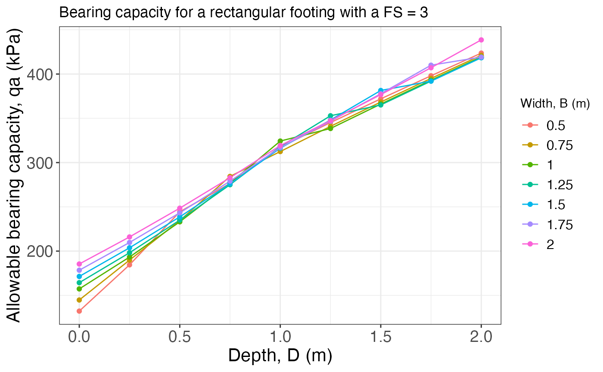

## Induced stress

The function `induced_stress` calculates and plots the stress
distribution under the center or corner (for rectangular or square
footings) of a footing of different shapes (“strip”, “square”,
“rectangular”, or “circular”), using the solutions from Boussinesq. The
arguments of the function are `qs`: the stress applied by the footing,
`B`: the width of the footing in meters, `L`: the length of the footing
in meters (applies only for rectangular footings), `z.end`: the depth
down to which calculate the stress, and `rect.pos`: the location for
which to calculate the stress (either “center” or “corner”). The
function returns a data frame with the stress values and two plots: one
static (`$Plot`) and one interactive (`$Plotly`), the last one is the
one shown here.

The first example shows the plot for the default “strip” footing, and
one value of width:

``` r

qs = 1
B = 1
L = NULL
z.end = 8
induced_stress(qs, B, L, z.end)$Plotly
```

The second example plots the results for a “square” footing and
different widths:

``` r

qs = 1
B = c(1, 2, 4)
L = NULL
z.end = 8
induced_stress(qs, B, L, z.end, footing = "square")$Plotly
```

The last example plots the results for a “rectangular” footing and
different lengths at both the center and the corner:

``` r

qs = 1
B = 1
L = c(1, 2, 4)
z.end = 8
induced_stress(qs, B, L, z.end, footing = "rectangular")$Plotly
```

``` r

induced_stress(
  qs,
  B,
  L,
  z.end,
  footing = "rectangular",
  rect.pos = "corner"
)$Plotly
```

## Insitu stress

The `insitu_stress` function builds the vertical stress profile with
depth for a layered soil, returning the total stress, pore pressure
(when a water table depth `NF` is supplied), and effective stress at
every depth increment. The required arguments are `boundaries`: a
numeric vector of layer bottom depths (m, strictly increasing), `soils`:
a character vector of soil names, and `unit_weights`: unit weights
($`kN/m^3`$) for each layer. The optional `NF` argument sets the water
table depth; omitting it (or `NF = NA`) gives a fully dry profile. The
function returns a list with a data frame (`$Profile`) and a ggplot2
graph (`$Graph`).

Define a four-layer soil profile:

``` r

boundaries <- c(6, 12, 22, 30)
soils <- c("Sandy silt", "Fine sand", "Clay", "Gravel")
unit_weights <- c(18.9, 20.8, 19.0, 18.5)
```

Dry profile (no water table):

``` r

res_dry <- insitu_stress(boundaries, soils, unit_weights)
res_dry$Profile
```

    ## # A tibble: 61 × 6
    ##    Depth Soil       Unit_Weight Total_Stress Pore_Pressure Effective_Stress
    ##    <dbl> <fct>            <dbl>        <dbl>         <dbl>            <dbl>
    ##  1   0   Sandy silt        18.9         0               NA             0   
    ##  2   0.5 Sandy silt        18.9         9.45            NA             9.45
    ##  3   1   Sandy silt        18.9        18.9             NA            18.9 
    ##  4   1.5 Sandy silt        18.9        28.4             NA            28.4 
    ##  5   2   Sandy silt        18.9        37.8             NA            37.8 
    ##  6   2.5 Sandy silt        18.9        47.2             NA            47.2 
    ##  7   3   Sandy silt        18.9        56.7             NA            56.7 
    ##  8   3.5 Sandy silt        18.9        66.2             NA            66.2 
    ##  9   4   Sandy silt        18.9        75.6             NA            75.6 
    ## 10   4.5 Sandy silt        18.9        85.1             NA            85.1 
    ## # ℹ 51 more rows

``` r

res_dry$Graph
```

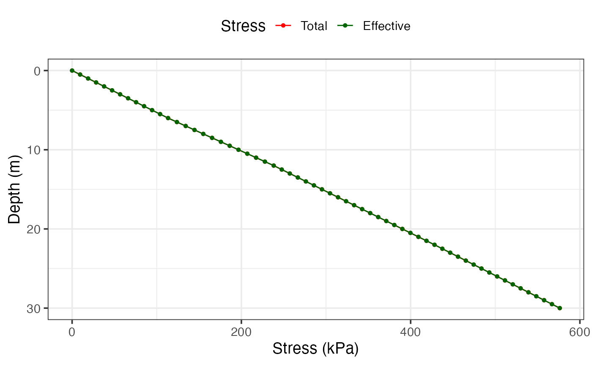

Profile with the water table at 12 m depth:

``` r

res_wt <- insitu_stress(boundaries, soils, unit_weights, NF = 12)
res_wt$Profile
```

    ## # A tibble: 61 × 6
    ##    Depth Soil       Unit_Weight Total_Stress Pore_Pressure Effective_Stress
    ##    <dbl> <fct>            <dbl>        <dbl>         <dbl>            <dbl>
    ##  1   0   Sandy silt        18.9         0               NA             0   
    ##  2   0.5 Sandy silt        18.9         9.45            NA             9.45
    ##  3   1   Sandy silt        18.9        18.9             NA            18.9 
    ##  4   1.5 Sandy silt        18.9        28.4             NA            28.4 
    ##  5   2   Sandy silt        18.9        37.8             NA            37.8 
    ##  6   2.5 Sandy silt        18.9        47.2             NA            47.2 
    ##  7   3   Sandy silt        18.9        56.7             NA            56.7 
    ##  8   3.5 Sandy silt        18.9        66.2             NA            66.2 
    ##  9   4   Sandy silt        18.9        75.6             NA            75.6 
    ## 10   4.5 Sandy silt        18.9        85.1             NA            85.1 
    ## # ℹ 51 more rows

``` r

res_wt$Graph
```


## Consistency (Atterberg) limits

### Casagrande cup liquid limit

`Casagrande_LL` fits a linear regression of water content vs
$`\log_{10}(N)`$ from a Casagrande cup test and estimates the liquid
limit at $`N = 25`$ blows. If `pl` (plastic limit) is supplied the
function also returns PI; adding `w` (natural water content) further
returns LI and CI.

Liquid limit only:

``` r

Casagrande_LL(N = c(15, 20, 28, 35), W = c(42, 38, 34, 31))$plot
```

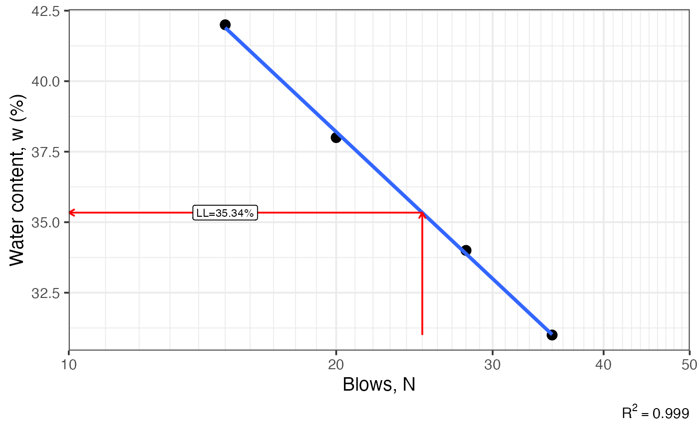

With plastic limit and natural water content (PI, LI, CI also computed):

``` r

res_ll <- Casagrande_LL(
  N = c(15, 20, 28, 35),
  W = c(42, 38, 34, 31),
  pl = 22,
  w = 30
)
res_ll$plot
```

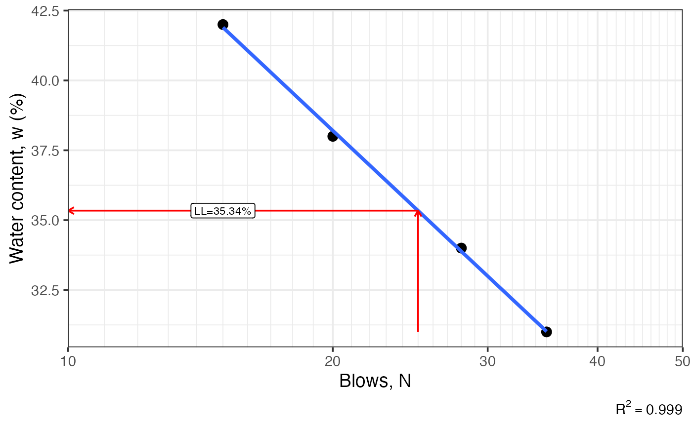

``` r

res_ll[c("ll", "pl", "pi", "li", "ci")]
```

    ## $ll
    ## [1] 35.34
    ## 
    ## $pl
    ## [1] 22
    ## 
    ## $pi
    ## [1] 13.34
    ## 
    ## $li
    ## [1] 0.6
    ## 
    ## $ci
    ## [1] 0.4

### Fall cone liquid and plastic limits

`fallcone_limits` fits a log-log regression of $`w`$ vs penetration from
a fall cone test. Use `limit = 'l'` for the liquid limit (80 g cone, 20
mm), `'p'` for the plastic limit (240 g cone, 20 mm), or `'b'` for both
(PL estimated at 2 mm; PI also returned).

Liquid limit only:

``` r

fallcone_limits(
  P = c(5.5, 7.8, 14.8, 22, 32),
  W = c(39.0, 44.8, 52.5, 60.3, 67.0)
)$plot
```

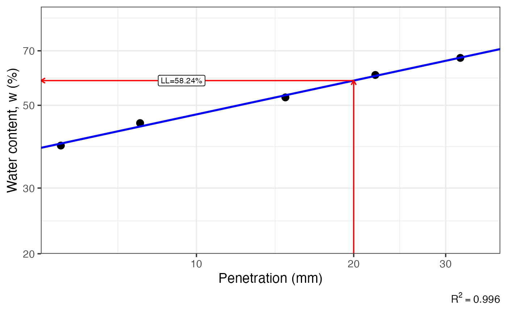

Both limits (LL and PL):

``` r

res_fc <- fallcone_limits(
  P = c(5, 9, 15, 22),
  W = c(20, 30, 43, 58),
  limit = 'b'
)
res_fc$plot
```

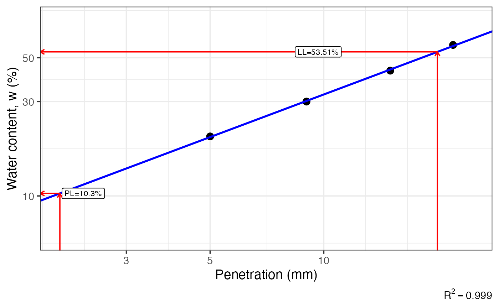

``` r

res_fc[c("ll", "pl", "pi")]
```

    ## $ll
    ## [1] 53.51
    ## 
    ## $pl
    ## [1] 10.3
    ## 
    ## $pi
    ## [1] 43.21

### Casagrande plasticity chart

`Casagrande_chart` produces the standard LL–PI chart with the A-line,
U-line, and CL-ML zone. It returns a ggplot2 object that can be further
annotated.

Reference chart only:

``` r

Casagrande_chart()
```

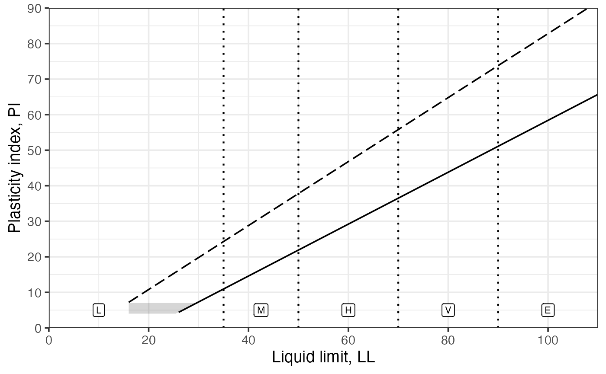

Overlaying sample data:

``` r

soil_df <- data.frame(
  ll = c(67, 58, 77, 51),
  pi = c(39, 19, 22, 20),
  sample = paste0("M", 1:4)
)

Casagrande_chart() +
  ggplot2::geom_point(
    ggplot2::aes(ll, pi, shape = sample, colour = sample),
    soil_df,
    size = 3
  ) +
  ggplot2::scale_shape_manual(values = 1:4)
```


## USCS classification

### Grain-size distribution graph

`particle_size_graph` returns an empty ggplot2 template with a log-scale
x-axis and the standard clay/silt/sand/gravel boundary lines at 0.002,
0.075, and 4.75 mm, ready for gradation data to be overlaid.

``` r

suelo <- dplyr::tribble(
  ~d     , ~pp    , ~sample ,
   0.075 ,  21.74 , "A"     ,
   0.150 ,  25.91 , "A"     ,
   0.250 ,  28.25 , "A"     ,
   0.425 ,  30.92 , "A"     ,
   0.850 ,  36.11 , "A"     ,
   2.000 ,  41.69 , "A"     ,
   4.750 ,  49.67 , "A"     ,
   9.500 ,  56.75 , "A"     ,
  12.700 ,  61.08 , "A"     ,
  25.400 ,  66.95 , "A"     ,
  38.100 ,  83.19 , "A"     ,
  50.800 , 100.00 , "A"     ,
   0.075 ,  42.96 , "B"     ,
   0.150 ,  47.79 , "B"     ,
   0.250 ,  52.18 , "B"     ,
   0.425 ,  55.82 , "B"     ,
   0.850 ,  62.80 , "B"     ,
   2.000 ,  75.11 , "B"     ,
   4.750 ,  87.86 , "B"     ,
   9.500 ,  96.25 , "B"     ,
  12.700 ,  97.97 , "B"     ,
  19.000 , 100.00 , "B"
)

particle_size_graph() +
  ggplot2::geom_point(
    ggplot2::aes(d, pp, shape = sample, colour = sample),
    suelo,
    size = 3
  ) +
  ggplot2::geom_line(
    ggplot2::aes(d, pp, colour = sample),
    suelo
  ) +
  ggplot2::scale_shape_manual(values = 1:2)
```

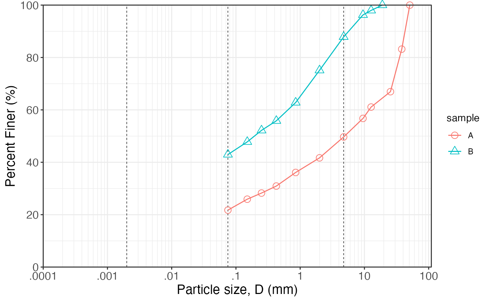

### USCS symbol and name

`USCS` classifies a soil sample according to ASTM D2487. Supply the
grain fractions (`pg`, `ps`, `pf`) and gradation coefficients (`Cu`,
`Cc`) for coarse-grained soils, plus Atterberg limits when fines exceed
5 %. For fine-grained soils ($`pf \ge 50`$%), only `pf`, `LL`, and `PI`
(or `PL`) are needed. Grain fractions and gradation coefficients can
also be derived automatically from `size` + `percent` vectors.

Lean clay:

``` r

USCS(pg = 15, ps = 34, pf = 51, Cc = 1, Cu = 4, LL = 40, PL = 10)
```

    ## $symbol
    ## [1] "CL"
    ## 
    ## $name
    ## [1] "Sandy lean clay with gravel"
    ## 
    ## $pg
    ## [1] 15
    ## 
    ## $ps
    ## [1] 34
    ## 
    ## $pf
    ## [1] 51

Well-graded gravel:

``` r

USCS(pg = 68, ps = 27, pf = 5, Cc = 2.1, Cu = 6.5, LL = 0, PL = 0, PI = 0)
```

    ## $symbol
    ## [1] "GW-GC"
    ## 
    ## $name
    ## [1] "Well-graded gravel with clay & sand (or silty clay & sand)"
    ## 
    ## $pg
    ## [1] 68
    ## 
    ## $ps
    ## [1] 27
    ## 
    ## $pf
    ## [1] 5
    ## 
    ## $Cu
    ## [1] 6.5
    ## 
    ## $Cc
    ## [1] 2.1

Fat clay:

``` r

USCS(pg = 2, ps = 8, pf = 90, LL = 65, PI = 35)
```

    ## $symbol
    ## [1] "CH"
    ## 
    ## $name
    ## [1] "Fat clay"
    ## 
    ## $pg
    ## [1] 2
    ## 
    ## $ps
    ## [1] 8
    ## 
    ## $pf
    ## [1] 90

Classification from grain-size distribution data:

``` r

USCS(
  percent = c(0, 10, 30, 60, 90, 100),
  size = c(0.075, 0.15, 0.3, 0.6, 1.18, 2.36),
  LL = 20,
  PL = 10
)
```

    ## $symbol
    ## [1] "SP"
    ## 
    ## $name
    ## [1] "Poorly-graded sand"
    ## 
    ## $pg
    ## [1] 0
    ## 
    ## $ps
    ## [1] 100
    ## 
    ## $pf
    ## [1] 0
    ## 
    ## $Cu
    ## [1] 4
    ## 
    ## $Cc
    ## [1] 1

## Direct shear

The functions for direct shear are more for visualizing the results
rather than to process them. The user should analyze the raw data and
provide the normal stress (`sig.n`, $`\sigma_n`$) - shear stress (`tau`,
$`\tau`$) pairs.

The first function plots the resulting $`(\sigma,\tau)`$ pairs and adds
a line of best fit for the Mohr-Coulomb criterion
($`\tau=c+\sigma_n tan\phi`$). If the line of best fit estimates an
intercept of less than 0 ($`c<0`$), the function automatically assigns
$`c=0`$, as this is not a possible solution. Also, the estimated
parameters ($`c,\phi`$) are added to the plot.

``` r

DS_plot(sig.n = c(80, 237, 395), tau = c(127, 345, 475))
```


The second function adds on top of the first one by drawing the Mohr
circles for each of the $`(\sigma,\tau)`$ pairs.

``` r

DS_Mohr_plot(sig.n = c(80, 237, 395), tau = c(127, 345, 475))
```

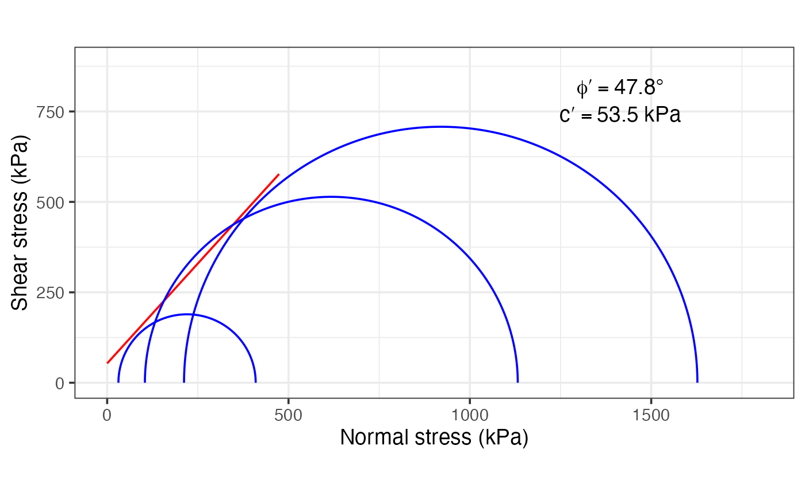

## Mohr circle

The idea here is to provide a way to solve simple Mohr circle’s problems
for the given normal stresses, shear stress, and rotation angle. The
function returns a plot and the results for the given problem and
parameters.

We can define some values to use:

``` r

sigx = 143.6
sigy = 100.5
tauxy = -14.4
theta = -35
```

where `sigx` corresponds to the mayor normal stress, `sigy` corresponds
to the minor normal stress, `tauxy` corresponds to the shear stress, and
`theta` is the rotation angle for which to find the stresses.

In the first example the rotation is not applied:

``` r

Mohr_Circle(sigx, sigy, tauxy)
```

    ## $results
    ##     sig1   sig2 sig_theta tau_theta tau_max
    ## 1 147.97 96.132     143.6     -14.4  25.918
    ## 
    ## $figure

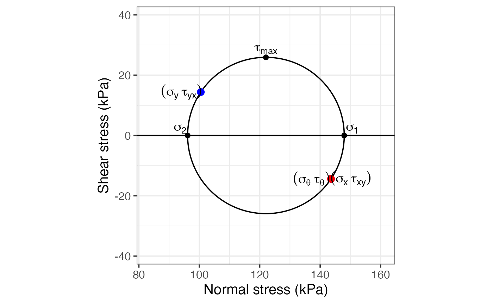

In the second example the rotation is applied:

``` r

Mohr_Circle(sigx, sigy, tauxy, theta)
```

    ## $results
    ##     sig1   sig2 sig_theta tau_theta tau_max
    ## 1 147.97 96.132    115.89   -25.175  25.918
    ## 
    ## $figure

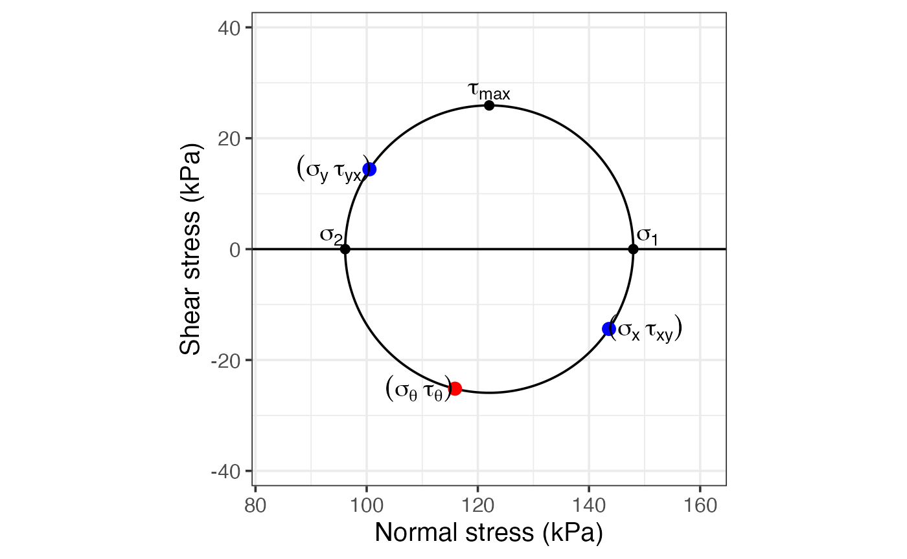

## Clay activity, expansion, and collapse

Three chart functions help classify the swelling and collapse potential
of fine-grained soils. All return ggplot2 objects that can be extended
with `+` to overlay sample data.

### Clay activity chart

`clay_activity` draws PI vs clay percentage with eight reference
activity lines (fitted by regression on built-in data). Activity
$`A = PI / \text{clay\%}`$ reflects the mineralogy of the clay fraction.

``` r

clay_activity()
```


Overlay sample points:

``` r

act_dat <- data.frame(
  clay = c(30, 45, 60),
  pi = c(55, 130, 210)
)

clay_activity() +
  ggplot2::geom_point(
    ggplot2::aes(clay, pi),
    act_dat,
    size = 3,
    inherit.aes = FALSE
  )
```

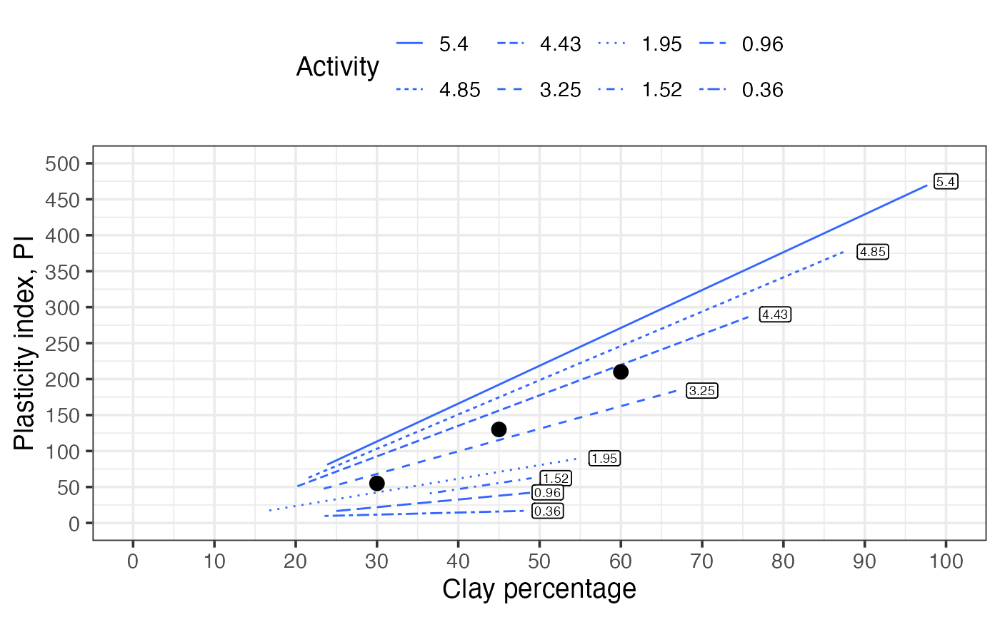

### Soil swelling potential chart

`soil_swelling` draws clay activity vs clay percentage with three
boundary curves separating the Low, Medium, High, and Very High swelling
potential zones.

``` r

soil_swelling()
```


Overlay sample points:

``` r

swell_dat <- data.frame(
  clay = c(20, 40, 60),
  activity = c(0.5, 1.0, 2.0)
)

soil_swelling() +
  ggplot2::geom_point(
    ggplot2::aes(clay, activity),
    swell_dat,
    size = 3,
    inherit.aes = FALSE
  )
```

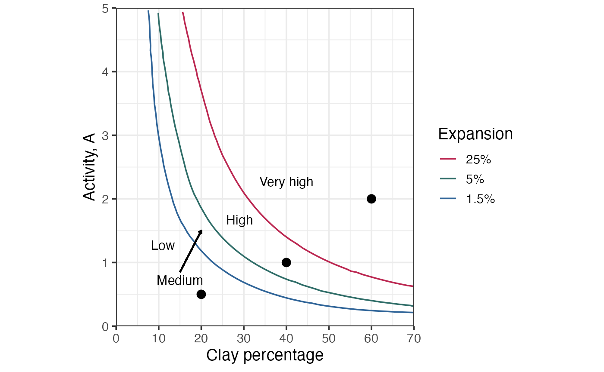

### Soil expansion potential chart

`soil_expansion` draws PI vs clay percentage with four boundary curves
for Low, Medium, High, and Very High expansion potential zones.

``` r

soil_expansion()
```


Overlay sample points:

``` r

exp_dat <- data.frame(
  clay = c(20, 40, 60),
  pi = c(10, 23, 40)
)

soil_expansion() +
  ggplot2::geom_point(
    ggplot2::aes(clay, pi),
    exp_dat,
    size = 3,
    inherit.aes = FALSE
  )
```

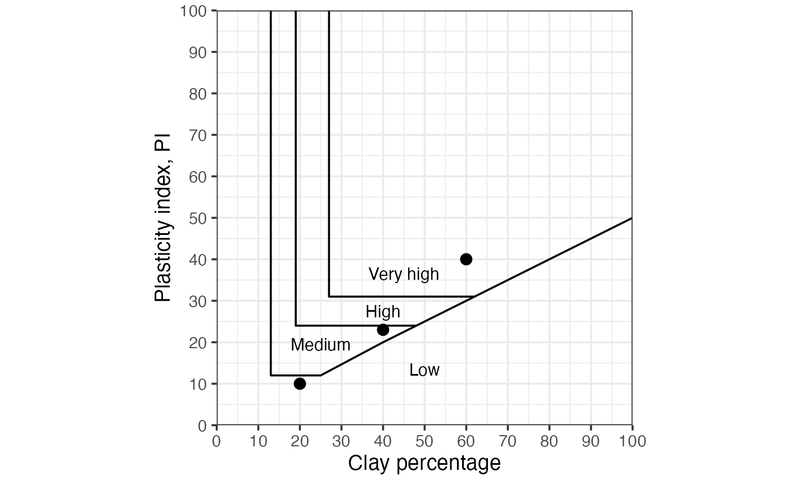

### Soil collapse potential chart

`soil_collapse` draws dry density vs liquid limit with two boundary
curves ($`G_s = 2.60`$ and $`G_s = 2.70`$) and dashed reference lines at
LL = 40, 50, and 63, separating zones of Low, Medium, High, and Very
High collapse and expansion potential.

``` r

soil_collapse()
```


Overlay sample points:

``` r

coll_dat <- data.frame(
  ll = c(20, 40, 60, 80),
  dry = c(1.50, 1.15, 1.20, 1.00)
)

soil_collapse() +
  ggplot2::geom_point(
    ggplot2::aes(ll, dry),
    coll_dat,
    size = 3,
    inherit.aes = FALSE
  )
```

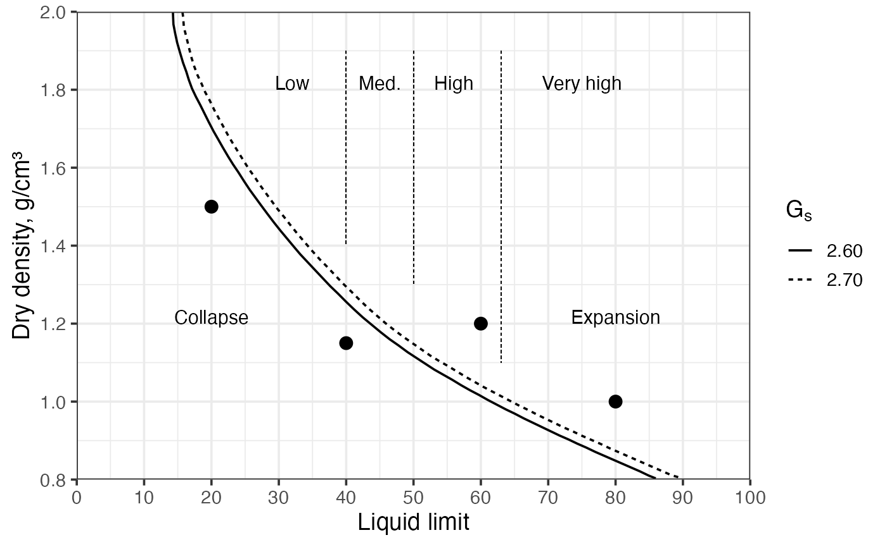

## Shinyapp

A shinyapp using these functions can be accessed at
<https://maximiliano-01.shinyapps.io/soil_mechanics/>.
